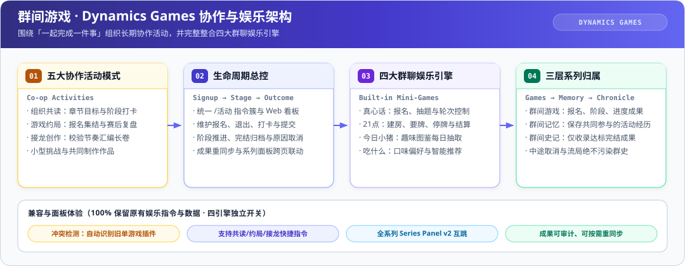

# 群间游戏 · Dynamics Games

**群间系列协作活动与娱乐总控：围绕「一起完成一件事」组织群聊共创，并完整整合四大经典群聊娱乐引擎。**

[核心能力](#核心能力) · [常用指令](#常用指令) · [系列联动](#三层系列职责边界) · [群间系列生态](#群间系列生态) · [文档与许可](#进阶文档与许可)

---

## 核心能力

- **五大群聊协作模式（「一起完成一件事」）**：支持**组织共读**、**游戏约局**、**接龙创作**、**小型挑战**与**共同制作作品**，完整管理活动发起、成员报名、阶段推进、打卡提交、完结归档与取消原因。
- **四大群聊娱乐引擎整合**：完整内置**真心话**（`truth_game`）、**21 点**（`blackjack21`）、**今日小猪**（`rollpig`）与**是啊，吃什么**（`what_to_eat`），兼容原有指令习惯并自动继承部分持久化数据（自定义资源与旧独立插件配置请按下方升级指南手动迁移），支持在 Web 面板按需独立开关，并自动识别旧独立小游戏插件冲突进入待机态防冲突。
- **群间游戏工作台**：提供运行总览、协作活动看板（新建/推进/定稿）、成果归档与重同步以及娱乐引擎开关，支持与群间全系列面板互跳与跨页会话（UMO）同步。

## 三层系列职责边界

| 所属插件 | 归属职责 |
| --- | --- |
| **群间游戏 · Dynamics Games** | 负责活动的**报名、阶段、进度与成果**，并统一调度四大群聊娱乐引擎 |
| **群间记忆 · Dynamics Memory** | 负责**保存共同参与的活动经历**，供日常对话与长期召回自然引用 |
| **群间史记 · Dynamics Chronicle** | 负责**收录达到协作门槛的完结成果**（中途取消、流局或临时局绝不入史） |

## 常用指令

### 协作活动（支持前缀 `/活动`、`/群间游戏`、`/共创`、`/games`）

- 快捷发起：`/共读 书名 | 目标章数 | 阶段1>阶段2` · `/约局 游戏名 | 目标人数 | 阶段` · `/接龙 主题 | 目标棒数` · `/挑战 挑战名 | 目标打卡次数` · `/活动 发起 共创 作品名 | 目标段落数`
- 全周期控制：`/活动 列表` · `/活动 详情 [ID]` · `/活动 报名 [ID]` · `/活动 退出 [ID]` · `/活动 打卡 内容` · `/活动 提交 内容` · `/活动 阶段 [ID]` · `/活动 完结 [摘要]` · `/活动 取消 [原因]` · `/活动 成果 [ID]` · `/活动 娱乐`

### 内置四大娱乐引擎

- **真心话**：`/真心话` · `/报名真心话` · `/开始真心话` · `/下一题` · `/跳过` · `/结束真心话`
- **21 点**：`/创建21点` · `/加入21点` · `/开始21点` · `/要牌` · `/停牌`
- **今日小猪**：`今日小猪`
- **吃什么**：`@Bot 吃什么` · `/口味` · `/喜欢吃` · `/不吃`

---

## 从旧独立小游戏插件升级与迁移

若此前曾安装独立版 `astrbot_plugin_truth_game`、`astrbot_plugin_blackjack21`、`astrbot_plugin_rollpig` 或 `astrbot_plugin_what_to_eat`，启用群间游戏前请先**停用旧独立插件**再重载（共存时群间游戏会自动进入冲突待机态以避免重复响应）。

### 自动继承项（无需手动搬运）

- **原有群聊指令习惯**：真心话、21 点、今日小猪、吃什么原有指令前缀与别名保持兼容。
- **今日小猪每日抽卡记录**：沿用 `data/plugin_data/astrbot_plugin_rollpig/rollpig_today.json`。
- **吃什么用户口味记忆**：沿用 `data/plugin_data/astrbot_plugin_what_to_eat/taste_memory.json`。
- *说明：真心话与 21 点的对局房间仅存于内存中（重载即重置，无历史数据文件）；群间协作活动库位于 `data/plugin_data/astrbot_plugin_dynamics_games/dynamics_games.db`。*

### 需手动迁移项（均相对 AstrBot 根目录）

| 迁移项 | 旧独立插件原路径 | 群间游戏目标路径 |
| --- | --- | --- |
| **自定义今日小猪图鉴与图片** | `data/plugins/astrbot_plugin_rollpig/resource/pig.json` `data/plugins/astrbot_plugin_rollpig/resource/image/` | `data/plugins/astrbot_plugin_dynamics_games/engines/rollpig/resource/pig.json` `data/plugins/astrbot_plugin_dynamics_games/engines/rollpig/resource/image/` |
| **自定义今日小猪字体** | `data/plugins/astrbot_plugin_rollpig/resource/font/`（如自备合法授权的 `可爱字体.ttf` 等） | `data/plugins/astrbot_plugin_dynamics_games/engines/rollpig/resource/font/`（未放置自定义正文覆盖字体时默认使用随包开源字体 `荆南麦圆体.otf`） |
| **吃什么自定义食物图片** | `data/plugins/astrbot_plugin_what_to_eat/images/` | `data/plugins/astrbot_plugin_dynamics_games/engines/what_to_eat/images/` |
| **旧独立插件配置** | `data/config/astrbot_plugin_truth_game_config.json` `data/config/astrbot_plugin_blackjack21_config.json` `data/config/astrbot_plugin_rollpig_config.json` `data/config/astrbot_plugin_what_to_eat_config.json` | `data/config/astrbot_plugin_dynamics_games_config.json` 中对应的 `truth_game` / `blackjack21` / `rollpig` / `what_to_eat` 分区（或直接在 AstrBot 插件配置页按需重新填写） |

---

## 群间系列生态

| 插件 | 仓库与标识 | 核心定位 |
| --- | --- | --- |
| **群间 · Chat Dynamics** | [`astrbot_plugin_chat_dynamics`](https://github.com/ysyhlly/astrbot_plugin_chat_dynamics) | 核心对话调度层：碎发聚合、话题路由、参与决策与节奏交付 |
| **群间世界 · Dynamics World** | [`astrbot_plugin_dynamics_world`](https://github.com/ysyhlly/astrbot_plugin_dynamics_world) | 角色卡、世界书、双地图天气、持续生活与 3D 实况小屋 |
| **群间记忆 · Dynamics Memory** | [`astrbot_plugin_dynamics_memory`](https://github.com/ysyhlly/astrbot_plugin_dynamics_memory) | 长期记忆、混合召回、2D/3D 图谱与原文证据冲突审查 |
| **群间学习 · Dynamics Learning** | [`astrbot_plugin_dynamics_learning`](https://github.com/ysyhlly/astrbot_plugin_dynamics_learning) | 固定性格红线下的成员资料、黑话好感与可回滚审查学习 |
| **群间见闻 · Dynamics Horizons** | [`astrbot_plugin_dynamics_horizons`](https://github.com/ysyhlly/astrbot_plugin_dynamics_horizons) | 角色隔离外部信息源与书架、自主精读与分群待讨论话题 |
| **群间游戏 · Dynamics Games**（当前） | [`astrbot_plugin_dynamics_games`](https://github.com/ysyhlly/astrbot_plugin_dynamics_games) | 共读/约局/接龙/挑战/共创协作与四大群聊娱乐引擎 |
| **群间史记 · Dynamics Chronicle** | [`astrbot_plugin_group_chronicle`](https://github.com/ysyhlly/astrbot_plugin_group_chronicle) | 原文依据的长期群史卷册、人物传记与群文化梗沿革 |
| **群间视觉 · Visual Media** | [`astrbot_plugin_visual_media`](https://github.com/ysyhlly/astrbot_plugin_visual_media) | 表情收集检索、多模态生图改图与角色视觉形象管理 |

---

## 进阶文档与许可

- 安装要求：AstrBot `>=4.29.4,<5`；启用前请停用旧版独立真心话/21点/今日小猪/吃什么插件以避免指令冲突。
- [发布说明与验证边界](RELEASE_NOTES.md) · [更新日志](CHANGELOG.md)
- 交流与反馈：项目反馈群兼聊天群 QQ `203363132`
- 本项目基于 [MIT License](LICENSE) 开源。
